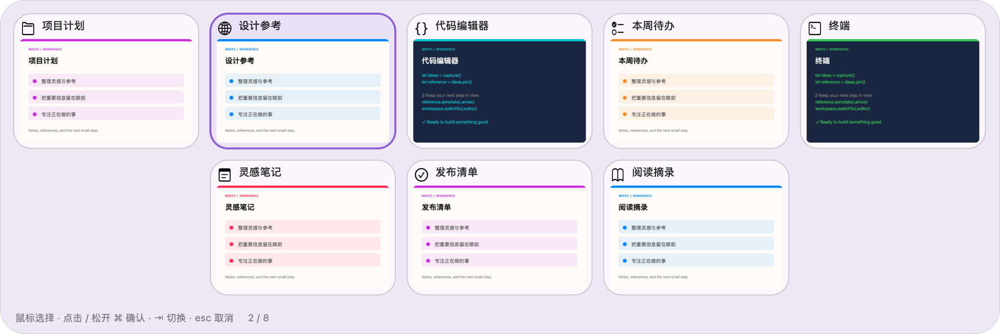

<p align="center">
  
</p>

<h1 align="center">Bento</h1>
<p align="center"><strong>切到要找的窗口，把参考图贴在手边。</strong></p>
<p align="center">窗口缩略图切换 · 拖文件跨窗口 · 截图自动复制与置顶 · 常用桌面工具</p>
<p align="center">
  <a href="https://github.com/chansigit/bento/releases/latest"><strong>下载 Bento ↗</strong></a>
  &nbsp; · &nbsp;
  <a href="bento/README.md">使用指南</a>
  &nbsp; · &nbsp;
  <a href="https://github.com/chansigit/bento/releases/latest">看看这次更新</a>
</p>
<p align="center"><sub>原生 macOS 应用 · Apple Silicon · 无第三方运行时依赖</sub></p>

---

浏览器、终端、文档开了一桌：用 **⌘Tab** 找到具体窗口，用 **⌘1** 把参考资料截成置顶贴图，拖文件时也能唤出藏在后面的目标窗口。

Bento 还把世界时钟、实时网速、独立滚动方向和显示器控制收进同一个菜单栏入口。

## ⌘Tab，直接切到那一个窗口

一个应用开了好几个窗口？按住 <kbd>⌘</kbd>，轻点 <kbd>Tab</kbd>，直接在窗口缩略图之间选择。找到那份文档、那页参考，或藏在后面的终端，不用先切应用再翻窗口。



- **键盘和鼠标都顺手。** Tab 向前、Shift+Tab 向后；也可以直接移动鼠标选择。点击或松开 ⌘，切过去。
- **拖文件，顺便切窗口。** 抓住文件不放，打开切换器，悬停目标缩略图唤出窗口，再把文件放进去。
- **刚用过的窗口就在前面。** 按最近使用顺序排列，按一次 ⌘Tab 切回上一个窗口；面板打开时顺序固定。

缩略图在内存中缓存，重新打开先显示缓存，再后台更新。

## ⌘1，截图直接变成桌面参考

<kbd>⌘</kbd> + <kbd>1</kbd> 框选，松开鼠标，选区就在**原位置、以原大小**成为置顶贴图。遮罩随即消失，继续操作桌面上的其他窗口。

截图会自动复制到剪贴板，切到目标应用按 <kbd>⌘</kbd> + <kbd>V</kbd> 粘贴。大图需短暂等待后台编码，图片保留原始分辨率。


对照设计写代码、照着资料填表、把一段说明留在眼前。**拖着走，滚轮缩放**，用完就关掉。

需要讲清重点时，展开下边缘的编辑栏：画箭头、加文字、圈出细节，或者用马赛克和遮挡处理信息。编辑栏随时收起，标注继续保留；贴图获得焦点时，按 **⌘C** 复制带标注的图片，按 **⌘S** 保存 PNG。


剪贴板里的图片也能直接贴出来：**Control + Option + P**。再加 **Shift** 隐藏／显示全部贴图。

<sub>以上为 Bento 真实组件渲染，窗口及图片内容均为演示素材。贴图在退出应用后关闭；需要留存时请先保存。</sub>

## 把桌面调到顺手的状态

| 你想做的事 | Bento 随手帮一下 |
|---|---|
| 看一眼异地现在几点 | **世界时钟** · 多时区紧凑显示，中文、英文、拼音都能搜城市。 |
| 鼠标反着滚，触控板自然滚 | **独立滚动方向** · 两个设备分别设置。 |
| 外接屏太亮 | **显示器亮度** · 调节支持 DDC/CI 的外接屏；目前自动匹配一台外接屏。 |
| Dock 跑到了另一块屏幕 | **Dock 固定** · 选择 Dock 所在屏幕，限制它在其他屏幕触发。 |
| 下载到底有没有在跑 | **实时网速** · 顶栏两行显示下载与上传，另可按需扫描 Wi-Fi 信号。 |
| 一堆文件夹，看着都一样 | **文件夹着色** · 八种颜色，在 Finder 里区分项目，也能恢复原图标。 |
| 不确定是不是开了大写 | **Caps Lock 提示** · 浮层、顶栏标记和可关闭的提示音。 |
| 跑任务时别让电脑睡着 | **防止休眠** · 一键临时保持唤醒。 |

菜单按功能分组，常用操作直接可见。截图与缩略图在本机内存处理，不上传。

## 下载，开始用

1. **[下载最新 DMG](https://github.com/chansigit/bento/releases/latest)**，把 Bento 拖入 Applications 并打开。
2. 按需为 `/Applications/Bento.app` 开启**辅助功能**与**屏幕录制**权限。菜单「Bento 设置 → 通用」可检查状态。
3. 按 **⌘Tab** 切一次窗口，再按 **⌘1** 贴一张参考图。

当前安装包面向 **Apple Silicon Mac**，最低声明系统版本为 macOS 11。应用使用自签名证书，未经过 Apple 公证；首次打开被拦截时，参见[安装与权限指南](bento/README.md#安装与权限)。

[权限与故障排查](bento/README.md#常见问题) · [版本记录](https://github.com/chansigit/bento/releases) · [提建议或报告问题](https://github.com/chansigit/bento/issues)

<details>
<summary>外观与语言</summary>

支持 15 款皮肤与 17 种语言，可在「Bento 设置 → 外观」切换。菜单、设置、窗口切换器及贴图编辑栏统一跟随皮肤；截图保持原色。

语言包括简体中文、繁體中文、English、日本語、한국어、Français、Español、Tiếng Việt、Svenska、Русский、Norsk bokmål、Suomi、Deutsch、Italiano、Українська、Kiswahili、Português (Brasil)。译文尚未经过全部语种的母语校对。

</details>

<details>
<summary>想自己编译？</summary>

准备好 Xcode Command Line Tools，然后：

```sh
git clone https://github.com/chansigit/bento.git
cd bento/bento
BUILD_ONLY=1 ./build.sh  # 测试、构建、签名；不改动已安装应用
```

构建结果为 `build/Bento.app`。要安装并重启 Bento，运行 `./build.sh`；只生成 DMG，运行 `./make-dist.sh`。

源码、资源与构建脚本在 [`bento/`](bento/)。构建会检查核心逻辑、窗口切换、截图标注、菜单交互、皮肤和语言资源；安装前备份旧应用，并检查签名身份。

Bento 前身为 GTime，内部 bundle ID 保持 `com.sijie.gtime`，以延续设置与权限。窗口切换已集成，无需另装 WinTab。

</details>
